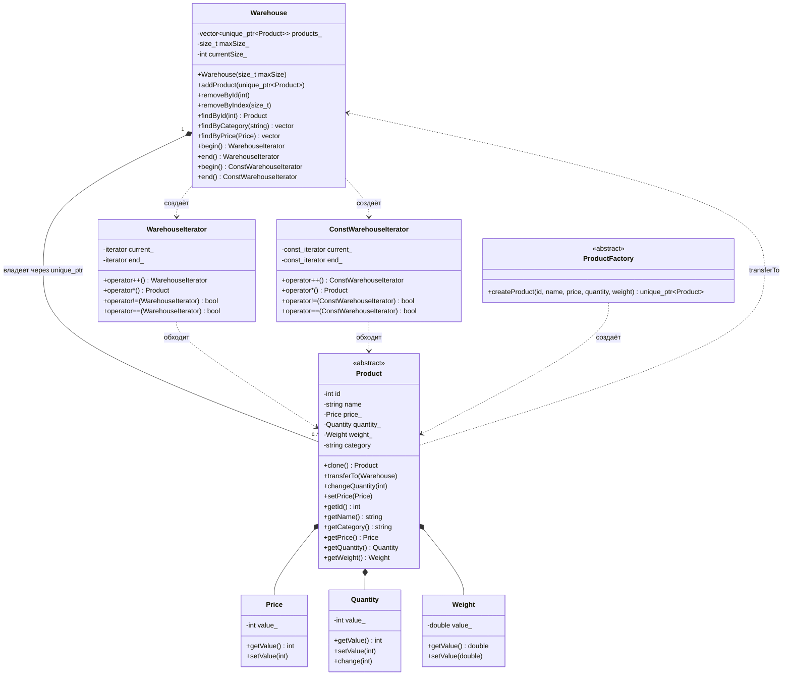
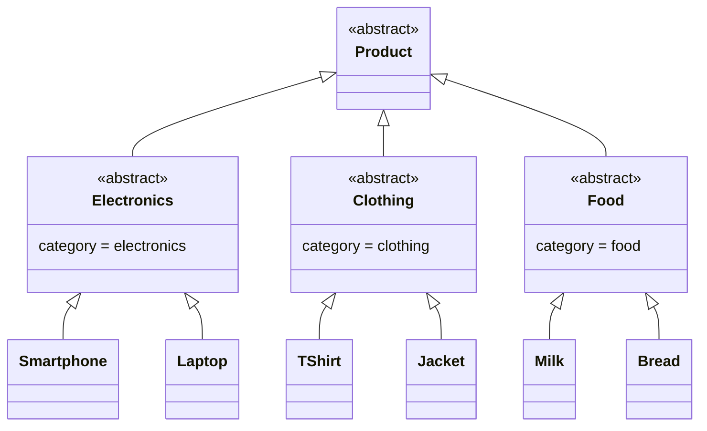
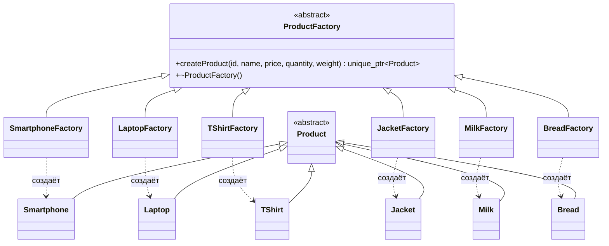
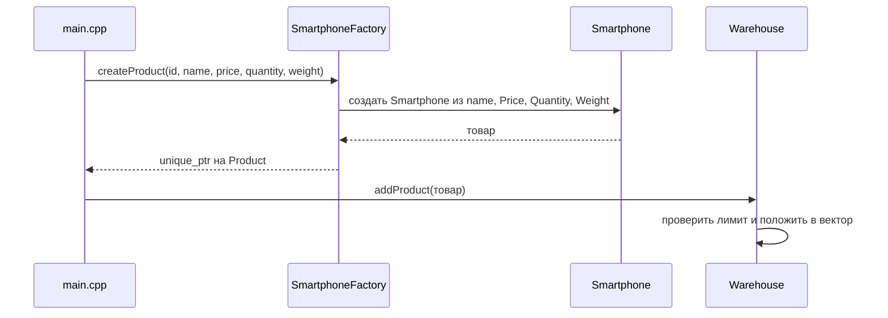
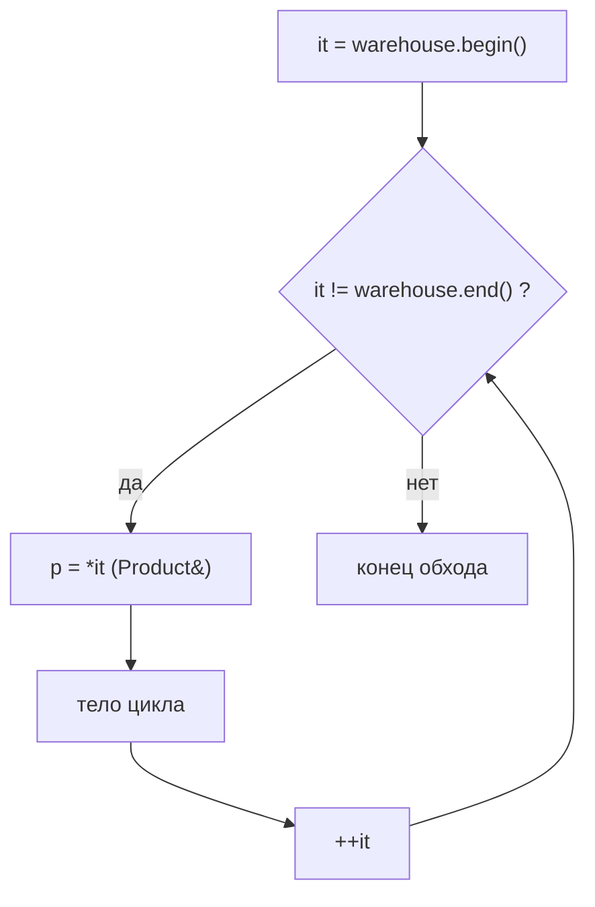

# Система управления складом на C++

Лабораторная работа по ООП: класс склада `Warehouse` с глубоким копированием и семантикой перемещения, иерархия товаров, паттерн «Фабричный метод» для создания товаров и собственный итератор для обхода склада.


## Содержание

1. [Цель и задача](#цель-и-задача)
2. [Структура проекта](#структура-проекта)
3. [Сборка и запуск](#сборка-и-запуск)
4. [Архитектура и UML](#архитектура-и-uml)
5. [Паттерн «Фабричный метод»](#паттерн-фабричный-метод)
6. [Паттерн «Итератор»](#паттерн-итератор)
7. [Правило пяти](#правило-пяти)
8. [Демонстрационные сценарии](#демонстрационные-сценарии)
9. [Тестирование](#тестирование)
10. [Соответствие критериям оценки](#соответствие-критериям-оценки)
11. [Выводы](#выводы)

---

## Цель и задача

**Цель.** Освоить основы ООП (классы, наследование, контейнеры) на примере системы управления складом и каталогом товаров, реализовать паттерн «Фабричный метод» для создания товаров и итератор для обхода склада.

**Что реализовано.**

| Компонент | Описание |
|---|---|
| `Warehouse` | Контейнер товаров с лимитом вместимости, добавлением, удалением (по id и по индексу), поиском (по id, категории, цене), глубоким копированием и перемещением |
| `Product` | Абстрактный базовый класс товара: `id`, `name`, `price`, `quantity`, `weight`, `category` |
| Категории и товары | 3 категории × 2 реализации: `Electronics` (`Smartphone`, `Laptop`), `Clothing` (`TShirt`, `Jacket`), `Food` (`Milk`, `Bread`) |
| Классы-атрибуты | `Price`, `Quantity`, `Weight` с проверкой на неотрицательность |
| `ProductFactory` и 6 фабрик | Паттерн «Фабричный метод» |
| `WarehouseIterator` и `ConstWarehouseIterator` | Собственные итераторы, совместимые с range-based `for` |
| `main.cpp` | Меню из пяти демонстрационных сценариев |

---

## Структура проекта

```text
.
├── .vscode/
│   └── tasks.json                                   задача сборки для VS Code (Ctrl+Shift+B)
├── Attributes/          Attributes.h / .cpp         Price, Quantity, Weight
├── Product/             Product.h / .cpp            абстрактный класс Product
├── Categories/          Categories.h / .cpp         Electronics, Clothing, Food
├── Products/            Products.h / .cpp           шесть конкретных товаров
├── Warehouse/           Warehouse.h / .cpp          Warehouse, WarehouseIterator, ConstWarehouseIterator
├── ProductFactories/    ProductFactories.h / .cpp   ProductFactory и шесть фабрик
├── .gitignore                                       исключает собранные *.exe из репозитория
├── main.cpp                                         меню демонстрационных сценариев
├── run.bat                                          запуск программы в Windows с кодировкой UTF-8
└── README.md                                        этот отчёт
```

Каждая пара `.h` / `.cpp` лежит в своей папке. Заголовки защищены `#pragma once`, свои заголовки подключаются в кавычках, `using namespace std` нигде не используется.

---

## Сборка и запуск

Нужен компилятор с поддержкой C++17 (проверено на g++ 13). Собранной программы в репозитории нет (`*.exe` исключены через `.gitignore`), поэтому сначала проект нужно собрать, а потом запустить.

### Шаг 1. Сборка

**VS Code в Windows.** В `.vscode/tasks.json` настроена задача сборки: она компилирует все `.cpp` из папок проекта с нужными флагами `-I` и кладёт `warehouse.exe` в корень проекта. Откройте папку проекта целиком и нажмите `Ctrl+Shift+B`. Путь к компилятору в задаче указан для MSYS2: `C:\msys64\ucrt64\bin\g++.exe`. Если g++ установлен в другом месте, измените поле `command` в `tasks.json`.

**Командная строка.** Любая система с g++, из корня проекта:

```bash
g++ -std=c++17 -IAttributes -ICategories -IProduct -IProducts -IWarehouse -IProductFactories \
    main.cpp Attributes/Attributes.cpp Categories/Categories.cpp Product/Product.cpp \
    Products/Products.cpp Warehouse/Warehouse.cpp ProductFactories/ProductFactories.cpp \
    -o warehouse
```

В Windows (cmd / PowerShell) команда та же, но в одну строку и без `\`; результат будет называться `warehouse.exe`, если указать `-o warehouse.exe`.

### Шаг 2. Запуск

**Windows.** Дважды щёлкните по `run.bat`. Файл включает кодировку UTF-8 (иначе русский текст в консоли превращается в набор символов), запускает `warehouse.exe` и по завершении держит окно открытым:

```bat
@echo off
chcp 65001 > nul
warehouse.exe
pause
```

Запускать `warehouse.exe` напрямую двойным щелчком не рекомендуется: без `chcp 65001` текст в окне будет нечитаемым. Если запускать вручную из терминала, сначала выполните `chcp 65001`, затем `.\warehouse.exe`.

**Linux / macOS.** `./warehouse` (терминал обычно уже работает в UTF-8).

После запуска появляется главное меню:

```text
==============================
   ДЕМОНСТРАЦИОННЫЕ СЦЕНАРИИ
==============================
   1. Склад, фабрики, итератор
   2. Копирование склада
   3. Перемещение склада
   4. Поиск и удаление товаров
   5. Перемещение товара (transferTo)
------------------------------
   0. Выход
==============================
```

---

## Архитектура и UML

### Общая диаграмма



> В диаграммах опущены `const`, ссылки и указатели, чтобы не перегружать запись.

### Иерархия товаров

Категория товара задаётся конструктором промежуточного класса: пользователь фабрики её не передаёт, она определяется типом.



Конструкторы образуют цепочку: `Smartphone(name, price, quantity, weight)` передаёт значения в `Electronics`, тот добавляет строку `"electronics"` и вызывает `Product(name, price, quantity, weight, category)`.

### Классы-атрибуты

Простые обёртки над примитивами. Они инкапсулируют значение и проверяют его при создании и изменении.

| Класс | Тип значения | Правило | Исключение |
|---|---|---|---|
| `Price` | `int` | значение не может быть отрицательным | `std::invalid_argument` |
| `Quantity` | `int` | значение не может быть отрицательным; `change(delta)` не даёт уйти ниже нуля | `std::invalid_argument` |
| `Weight` | `double` | значение не может быть отрицательным | `std::invalid_argument` |

Конструкторы объявлены `explicit`, поэтому число не превращается в атрибут неявно: в фабриках используется явная запись `Price(price)`, `Quantity(quantity)`, `Weight(weight)`.

### Ключевые проектные решения

| Решение | Как реализовано | Зачем |
|---|---|---|
| Владение товарами | `std::vector<std::unique_ptr<Product>>` | Склад единственный владелец товаров, утечки невозможны |
| Уникальный `id` | статический счётчик `Product::nextId_`, значение берётся в конструкторе `Product` | Идентификатор не зависит от вызывающего кода, параметр `id` в `createProduct` игнорируется |
| Глубокое копирование | виртуальный `clone()` в каждом конкретном товаре, копия через `new X(*this)` | Копия склада получает собственные объекты того же динамического типа |
| Передача параметров | константные ссылки `const T&` везде, где возможно | Нет лишних копий |
| Поиск | `findById` возвращает `Product*`, `findByCategory` и `findByPrice` возвращают `std::vector<Product*>` | Указатели не передают владение, товары остаются на складе |
| `transferTo` | клонирует товар и добавляет копию на склад-получатель | Единый интерфейс переноса между складами |

> `transferTo` не удаляет товар из склада-источника. Чтобы получить полноценное перемещение, после него вызывается `removeById` (так сделано в сценарии 5).

---

## Паттерн «Фабричный метод»

**Идея.** Код, которому нужен товар, не создаёт конкретные классы через `new`. Он обращается к фабрике через общий интерфейс `ProductFactory`, а конкретная фабрика решает, какой именно товар создать.

### Роли в паттерне

| Роль | Класс |
|---|---|
| Создатель (Creator) | `ProductFactory`, чисто виртуальный `createProduct` |
| Конкретные создатели | `SmartphoneFactory`, `LaptopFactory`, `TShirtFactory`, `JacketFactory`, `MilkFactory`, `BreadFactory` |
| Продукт (Product) | `Product` |
| Конкретные продукты | `Smartphone`, `Laptop`, `TShirt`, `Jacket`, `Milk`, `Bread` |

### Диаграмма



### Реализация

Интерфейс фабрики (`ProductFactories.h`):

```cpp
class ProductFactory{
    public:
    virtual std::unique_ptr<Product> createProduct(int id, const std::string& name, int price, int quantity, double weight) = 0;
    virtual ~ProductFactory() = default;
};
```

Конкретная фабрика (`ProductFactories.cpp`):

```cpp
std::unique_ptr<Product> SmartphoneFactory::createProduct(int id, const std::string& name, int price, int quantity, double weight){
    return std::make_unique<Smartphone>(name, Price(price), Quantity(quantity), Weight(weight));
}
```

Что важно:

- Метод возвращает `std::unique_ptr<Product>`: владение сразу переходит вызывающему коду, который передаёт его в `Warehouse::addProduct`.
- Деструктор `ProductFactory` виртуальный, поэтому фабрику можно безопасно удалять через указатель на базовый класс.
- Валидация происходит автоматически: если в фабрику передать отрицательную цену, конструктор `Price` бросит исключение ещё до создания товара, и счётчик `id` не расходуется.
- В `main.cpp` функция `chooseFactory` по номеру пункта меню возвращает `std::unique_ptr<ProductFactory>`, а дальше код работает только с базовым интерфейсом и не знает о конкретных классах.

### Как создаётся товар



---

## Паттерн «Итератор»

**Идея.** Обход склада не зависит от того, как товары хранятся внутри. Снаружи это обычные `for (auto& p : warehouse)`, а `unique_ptr` скрыт.

### Две реализации

| Класс | Хранит | `operator*` возвращает | Когда используется |
|---|---|---|---|
| `WarehouseIterator` | `vector<unique_ptr<Product>>::iterator` | `Product&` | обход обычного склада, товары можно менять |
| `ConstWarehouseIterator` | `vector<unique_ptr<Product>>::const_iterator` | `const Product&` | обход константного склада, товары менять нельзя |

У `Warehouse` для этого две пары методов, компилятор выбирает нужную по константности объекта:

| Метод | Возвращает |
|---|---|
| `begin()` / `end()` | `WarehouseIterator` |
| `begin() const` / `end() const` | `ConstWarehouseIterator` |

### Операции итератора

| Оператор | Что делает |
|---|---|
| `operator++` | сдвигает итератор на следующий товар, возвращает ссылку на себя |
| `operator*` | делает двойное разыменование `*(*current_)` и отдаёт сам товар, а не `unique_ptr` |
| `operator!=` / `operator==` | сравнивают текущие позиции |

```cpp
Product& WarehouseIterator::operator*() const{
    return *(*current_);
}
```

`begin()` возвращает итератор на первый товар, `end()` возвращает итератор «за последним»:

```cpp
WarehouseIterator Warehouse::begin(){
    return WarehouseIterator(products_.begin(), products_.end());
}

WarehouseIterator Warehouse::end(){
    return WarehouseIterator(products_.end(), products_.end());
}
```

### Как работает `for (auto& p : warehouse)`

Компилятор разворачивает цикл в вызовы тех самых операторов:



На пустом складе `begin() == end()`, поэтому тело цикла не выполняется ни разу.

Цикл `for (const auto& p : warehouse)` на константном складе (функция `printWarehouse`) использует `ConstWarehouseIterator`, и через `p` можно вызвать только константные методы (`getId()`, `getPrice()` и другие), а `changeQuantity` и `setPrice` компилятор не пропустит.

---

## Правило пяти

Для `Warehouse` все пять специальных функций написаны явно, хотя `std::vector` позволил бы положиться на автоматические. Это демонстрирует навык работы с владением.

| Функция | Сигнатура | Что делает |
|---|---|---|
| Конструктор | `Warehouse(size_t maxSize)` | задаёт лимит, при `maxSize == 0` бросает `std::invalid_argument` |
| Конструктор копирования | `Warehouse(const Warehouse& other)` | глубокое копирование: каждый товар клонируется через `clone()` |
| Оператор присваивания копированием | `Warehouse& operator=(const Warehouse& other)` | проверка самоприсваивания, очистка своих товаров, клонирование чужих |
| Конструктор перемещения | `Warehouse(Warehouse&& other) noexcept` | забирает вектор через `std::move`, без копирования товаров; у `other` обнуляется счётчик |
| Оператор присваивания перемещением | `Warehouse& operator=(Warehouse&& other) noexcept` | проверка самоприсваивания, перенос вектора, обнуление счётчика у `other` |
| Деструктор | `~Warehouse() = default` | вектор уничтожает `unique_ptr`, а те освобождают товары |

Почему так:

- **Глубокое копирование** нужно, потому что `unique_ptr` скопировать нельзя, а склады не должны делить товары. Виртуальный `clone()` создаёт копию с тем же динамическим типом.
- **`noexcept`** у операций перемещения честный: они ничего не бросают. Это важно, потому что стандартные контейнеры используют перемещение вместо копирования только для таких операций.
- **Самоприсваивание** при перемещении без проверки уничтожило бы товары, поэтому `this == &other` проверяется в обоих операторах.
- **Состояние после перемещения.** Склад-источник пуст, но остаётся пригодным к использованию: лимит сохраняется, и в него можно снова добавлять товары.

---

## Демонстрационные сценарии

Все сценарии запускаются из главного меню. Между меню программа очищает экран, а после результата сценария ждёт нажатия Enter. Ниже приведён реальный вывод программы, служебные строки «Нажмите Enter, чтобы продолжить...» в блоках опущены.

### Сценарий 1. Создание склада, добавление через фабрики, вывод через итератор

Пользователь выбирает тип товара в меню, фабрика создаёт объект по введённым параметрам, склад принимает его. В конце все товары выводятся через итератор. Некорректный ввод не приводит к падению.

```text
Склад создан, вместимость: 10 товаров

==============================
   ДОБАВЛЕНИЕ ТОВАРА
==============================
 Электроника
   1. Смартфон
   2. Ноутбук
 Одежда
   3. Футболка
   4. Куртка
 Продукты
   5. Молоко
   6. Хлеб
------------------------------
   0. Закончить добавление
==============================
Ваш выбор: 1
Название: Phone
Цена: 500
Количество: 3
Вес (кг): 0.2

(экран очищается, над меню печатается: «Товар добавлен: Phone»)
Ваш выбор: 4
Название: Jacket
Цена: 80
Количество: 4
Вес (кг): 0.9

(над меню: «Товар добавлен: Jacket»)
Ваш выбор: 5
Название: Milk
Цена: 2
Количество: 30
Вес (кг): 1.0

(над меню: «Товар добавлен: Milk»)
Ваш выбор: 3
Название: Shirt
Цена: -20
Количество: 5
Вес (кг): 0.2

(над меню: «Ошибка: Price can't be negative»)
Ваш выбор: 0

=== Товары на складе ===
id: 1 | Phone | категория: electronics | цена: 500 | кол-во: 3 | вес: 0.2 кг
id: 2 | Jacket | категория: clothing | цена: 80 | кол-во: 4 | вес: 0.9 кг
id: 3 | Milk | категория: food | цена: 2 | кол-во: 30 | вес: 1 кг
```

Что демонстрируется: работа фабрик через общий интерфейс, автоматическая валидация атрибутов (отрицательная цена отклонена, товар не добавлен), вывод через итератор. Остальные случаи ввода обрабатываются так же: буквы вместо числа дают «Ошибка ввода, товар не добавлен», а при заполнении склада до лимита следующий товар отклоняется с сообщением `Warehouse is full`.

### Сценарий 2. Копирование склада

Создаётся склад из трёх товаров, затем конструктором копирования создаётся его копия. В копии у каждого товара остаток уменьшается на 2, а цена увеличивается на 100.

```text
=== Оригинал до копирования ===
id: 1 | Smartphone | категория: electronics | цена: 500 | кол-во: 10 | вес: 0.2 кг
id: 2 | Laptop | категория: electronics | цена: 1200 | кол-во: 5 | вес: 2.1 кг
id: 3 | Milk | категория: food | цена: 2 | кол-во: 20 | вес: 1 кг

=== Копия после изменений ===
id: 1 | Smartphone | категория: electronics | цена: 600 | кол-во: 8 | вес: 0.2 кг
id: 2 | Laptop | категория: electronics | цена: 1300 | кол-во: 3 | вес: 2.1 кг
id: 3 | Milk | категория: food | цена: 102 | кол-во: 18 | вес: 1 кг

=== Оригинал после изменений копии ===
id: 1 | Smartphone | категория: electronics | цена: 500 | кол-во: 10 | вес: 0.2 кг
id: 2 | Laptop | категория: electronics | цена: 1200 | кол-во: 5 | вес: 2.1 кг
id: 3 | Milk | категория: food | цена: 2 | кол-во: 20 | вес: 1 кг

Оригинал не изменился, копия независима: да
```

Что демонстрируется: глубокое копирование. Изменения в копии не затрагивают оригинал, потому что `clone()` создал отдельные объекты. Программа дополнительно проверяет, что адреса товаров в оригинале и копии различаются, а значения разошлись.

### Сценарий 3. Перемещение склада

Склад перемещается конструктором перемещения, затем присваиванием перемещением.

```text
=== Склад до перемещения ===
id: 1 | Smartphone | категория: electronics | цена: 500 | кол-во: 10 | вес: 0.2 кг
id: 2 | Milk | категория: food | цена: 2 | кол-во: 20 | вес: 1 кг

=== Новый склад после перемещения ===
id: 1 | Smartphone | категория: electronics | цена: 500 | кол-во: 10 | вес: 0.2 кг
id: 2 | Milk | категория: food | цена: 2 | кол-во: 20 | вес: 1 кг

=== Старый склад после перемещения ===
Склад пуст

Товары не копировались (адреса совпадают): да

=== Склад после присваивания перемещением ===
id: 1 | Smartphone | категория: electronics | цена: 500 | кол-во: 10 | вес: 0.2 кг
id: 2 | Milk | категория: food | цена: 2 | кол-во: 20 | вес: 1 кг

=== Промежуточный склад после присваивания ===
Склад пуст

Товары не копировались (адреса совпадают): да
```

Что демонстрируется: отсутствие копирования. Адреса товаров до и после перемещения совпадают, то есть переносится сам вектор с `unique_ptr`, а объекты остаются на месте. Старый склад после перемещения пуст.

### Сценарий 4. Поиск и удаление

На склад из пяти товаров применяются поиск по id, категории и цене, затем удаление по id и по индексу. Отдельно показаны случаи ошибок.

```text
=== Склад ===
id: 1 | Smartphone | категория: electronics | цена: 500 | кол-во: 10 | вес: 0.2 кг
id: 2 | Laptop | категория: electronics | цена: 1200 | кол-во: 5 | вес: 2.1 кг
id: 3 | T-Shirt | категория: clothing | цена: 20 | кол-во: 50 | вес: 0.2 кг
id: 4 | Milk | категория: food | цена: 2 | кол-во: 20 | вес: 1 кг
id: 5 | Bread | категория: food | цена: 2 | кол-во: 30 | вес: 0.5 кг

--- Поиск по id 1 ---
id: 1 | Smartphone | категория: electronics | цена: 500 | кол-во: 10 | вес: 0.2 кг

--- Поиск по категории food ---
id: 4 | Milk | категория: food | цена: 2 | кол-во: 20 | вес: 1 кг
id: 5 | Bread | категория: food | цена: 2 | кол-во: 30 | вес: 0.5 кг

--- Поиск по цене 2 ---
id: 4 | Milk | категория: food | цена: 2 | кол-во: 20 | вес: 1 кг
id: 5 | Bread | категория: food | цена: 2 | кол-во: 30 | вес: 0.5 кг

--- Поиск по категории toys ---
Ничего не найдено

Поиск по id -1: ошибка: This Id isn't exist

=== После удаления по id 2 ===
id: 1 | Smartphone | категория: electronics | цена: 500 | кол-во: 10 | вес: 0.2 кг
id: 3 | T-Shirt | категория: clothing | цена: 20 | кол-во: 50 | вес: 0.2 кг
id: 4 | Milk | категория: food | цена: 2 | кол-во: 20 | вес: 1 кг
id: 5 | Bread | категория: food | цена: 2 | кол-во: 30 | вес: 0.5 кг

=== После удаления по индексу 0 ===
id: 3 | T-Shirt | категория: clothing | цена: 20 | кол-во: 50 | вес: 0.2 кг
id: 4 | Milk | категория: food | цена: 2 | кол-во: 20 | вес: 1 кг
id: 5 | Bread | категория: food | цена: 2 | кол-во: 30 | вес: 0.5 кг

Удаление по id -1: ошибка: This Id isn't exist
Удаление по индексу 100: ошибка: Index out of range
```

Что демонстрируется: все три вида поиска (в том числе пустой результат), оба вида удаления, исключения при несуществующем id и выходе индекса за границы.

### Сценарий 5. Перемещение товара между складами

Товар переносится с одного склада на другой методом `transferTo`, затем у перенесённого товара меняются остаток и цена. Склад-получатель имеет вместимость 1, чтобы показать переполнение.

```text
=== Склад-источник до переноса ===
id: 1 | Smartphone | категория: electronics | цена: 500 | кол-во: 10 | вес: 0.2 кг
id: 2 | Laptop | категория: electronics | цена: 1200 | кол-во: 5 | вес: 2.1 кг

=== Склад-получатель до переноса ===
Склад пуст

=== Склад-источник после переноса ===
id: 2 | Laptop | категория: electronics | цена: 1200 | кол-во: 5 | вес: 2.1 кг

=== Склад-получатель после переноса ===
id: 1 | Smartphone | категория: electronics | цена: 500 | кол-во: 10 | вес: 0.2 кг

=== Склад-получатель после изменения остатка и цены ===
id: 1 | Smartphone | категория: electronics | цена: 450 | кол-во: 7 | вес: 0.2 кг

Изменение остатка на -1000: ошибка: Quantity can't be negative
Перенос в заполненный склад: ошибка: Warehouse is full

=== Склад-источник (ноутбук остался на месте) ===
id: 2 | Laptop | категория: electronics | цена: 1200 | кол-во: 5 | вес: 2.1 кг
```

Что демонстрируется: `transferTo`, изменение остатка (`changeQuantity`) и цены (`setPrice`), защита от отрицательного остатка и от переполнения склада-получателя. При неудачном переносе товар остаётся на складе-источнике.

---

## Тестирование

Проверка проводилась запуском программы через меню (в том числе с некорректным вводом) и отдельной проверочной программой, которая в репозиторий не входит. Все сценарии дополнительно запускались под AddressSanitizer и UBSan: замечаний и утечек памяти нет.

| Область | Что проверено | Результат |
|---|---|---|
| Атрибуты | отрицательные значения в конструкторах и `setValue` у `Price`, `Quantity`, `Weight` отклоняются, значение при этом не портится; ноль допустим; `Quantity::change` не уходит ниже нуля | пройдено |
| Фабрики | все шесть фабрик создают объект нужного типа и категории, `id` уникальны, некорректные параметры дают исключение, `clone()` сохраняет динамический тип | пройдено |
| Конструктор копирования | товары копируются глубоко, изменения в копии не влияют на оригинал, лимит склада копируется, копия пустого склада работает | пройдено |
| Присваивание копированием | старое содержимое заменяется, самоприсваивание безопасно | пройдено |
| Конструктор и присваивание перемещением | адреса товаров сохраняются, источник пуст и пригоден к использованию, операции `noexcept`, самоперемещение безопасно | пройдено |
| Итератор | пустой склад, обход по порядку, `!=` и `==`, изменение товара через итератор, константный итератор не позволяет менять товары | пройдено |
| Операции склада | лимит вместимости, границы индекса, несуществующий id, пустой результат поиска, добавление после опустошения | пройдено |
| Меню и ввод | нечисловой ввод, несуществующий пункт, отрицательные значения, заполнение склада до лимита | пройдено |

---

## Соответствие критериям оценки

| № | Критерий | Баллы | Где реализовано |
|---|---|---|---|
| 1 | Класс `Warehouse`: создание, ограничение размера, добавление/удаление, копирование, поиск, итерация | 20 | `Warehouse/Warehouse.h`, `Warehouse.cpp` |
| 2 | Иерархия товаров (3 типа × 2 реализации, общий интерфейс) | 15 | `Product/`, `Categories/`, `Products/` |
| 3 | Классы атрибутов `Price`, `Quantity`, `Weight` | 10 | `Attributes/` |
| 4 | Конструкторы копирования и перемещения | 10 | `Warehouse::Warehouse(const Warehouse&)`, `Warehouse::Warehouse(Warehouse&&)` и соответствующие операторы присваивания |
| 5 | Паттерн «Фабричный метод» | 25 | `ProductFactories/` |
| 6 | Итератор для склада | 15 | `WarehouseIterator`, `ConstWarehouseIterator` в `Warehouse/` |
| 7 | Программа разбита на файлы | 5 | пары `.h` / `.cpp` в отдельных папках |

---

## Выводы

- Реализована система склада с иерархией из шести товаров, классами-атрибутами с валидацией и контейнером с лимитом вместимости.
- Паттерн «Фабричный метод» позволил отделить создание товаров от кода, который с ними работает: `main.cpp` оперирует только интерфейсом `ProductFactory` и `unique_ptr<Product>`.
- Собственные итераторы скрывают способ хранения товаров и совместимы с range-based `for`. Пара из обычного и константного итератора обеспечивает защиту товаров от изменения там, где это нужно.
- Явное правило пяти для `Warehouse` показало разницу между глубоким копированием (через виртуальный `clone()`) и перемещением (передача вектора без копирования объектов).
- Использование `std::unique_ptr` сделало владение товарами однозначным, при этом утечек памяти нет.

**Известные ограничения** (ТЗ их не требует, поэтому они оставлены без исправления):

- `Warehouse::addProduct` не проверяет, что переданный `unique_ptr` не пустой.
- Конструктор `Weight` пропускает значение `NaN`, так как `NaN < 0` ложно.
- `transferTo` на тот же склад добавляет второй товар с тем же `id`.
- `transferTo` копирует товар и не удаляет оригинал из источника, поэтому для полноценного перемещения нужен отдельный вызов `removeById`.
